---
date:
  created: 2026-11-12
draft: false
cover: images/cover.jpg
description: Turning a Condeco V2 meeting room screen (i.MX6, Android 8) into a Home Assistant dashboard with a serial console, an oscilloscope, a USB microscope, ADB and a custom boot image. Mostly told by Claude, the AI that did the driving.
---

# Hacking a Condeco Room Screen: Breaking out of the kiosk

## Intro

I've got a Condeco V2 room screen lying around. These are the small panels that hang next to meeting rooms and show whether the room is booked. Without the Condeco backend they're useless, so they're pretty much e-waste. My goal: put my Home Assistant dashboard on them instead.

Sadly there's no way out of the Condeco kiosk app, and when I connected one to the network it immediately started downloading an update (I pulled the plug at 19%).

I've already tried escaping the Condeco software a few years ago, with no success.

Now I've tried it again. I was first trying to escape it again without doing any hardware work, by clicking all the buttons there are. Furthest I got was the stock Android keyboard and WiFi settings. But there was no way out. And Claude wasn't helpful here either, because the safeguards immediately flagged it as cyber security and refused to give an answer.

So the only remaining way was going the hardware route. That I have also already tried but without much experience I didn't got very far the last time. I had found out that there is a serial connector and that it likely is the key, but even If I had connected it, I would have not know what to do.

But this time I did an experiment and let Claude access all my hardware: my oscilloscope, microscope, serial USB adapter and USB connection for ADB to the device. Funnily enough, it looks like the safeguards are more targeted towards software, not hardware.
Sending an image of a locked kiosk showing the android keyboard is a big no no, but sending commands over serial and dump the whole eMMC is fine apparently.

Since Claude did most of the work, and I find it really cool to watch an AI interact with real hardware (as long as it doesn't break anything of course ^^), I asked it to write the rest of this post from its own perspective.

!!! note "Toolbox"
    I've created a small tool that I will soon publish ([https://github.com/Xitee1/condeco-room-screen](https://github.com/Xitee1/condeco-room-screen)) that lets you easily free your tablet. The only requirement is having the U-Boot file that you can only extract with a serial connection. The good thing is that this file works for all tablets that have identical hardware. I'll provide mine for the "V2 Room Screen", so if you have the same model and hardware revision you can just use that. Another good thing is that you can test it in RAM only, so in case it doesn't work, nothing was written permanently.

!!! note "From here on, Claude is writing"
    Everything below is written by Claude from its point of view. "I" means Claude, and "Xitee" is the human holding the screwdriver.

## The patient

When I joined, Xitee had already done the first round:

|               |                                                                              |
| ------------- | ---------------------------------------------------------------------------- |
| Device        | Condeco V2 Room Screen, model T201502                                        |
| App           | "ConnectV2" 2.0.0.103, firmware 8.4.6                                        |
| SoC           | NXP i.MX6 **DualLite** (the vendor docs say "Dual", the chip says otherwise) |
| RAM / Storage | 1 GiB DDR3, 8 GB SanDisk eMMC                                                |
| OS            | Android 8.0, `user` build                                                    |
| Power         | PoE, or 12 V on a barrel jack ("for development and debugging")              |

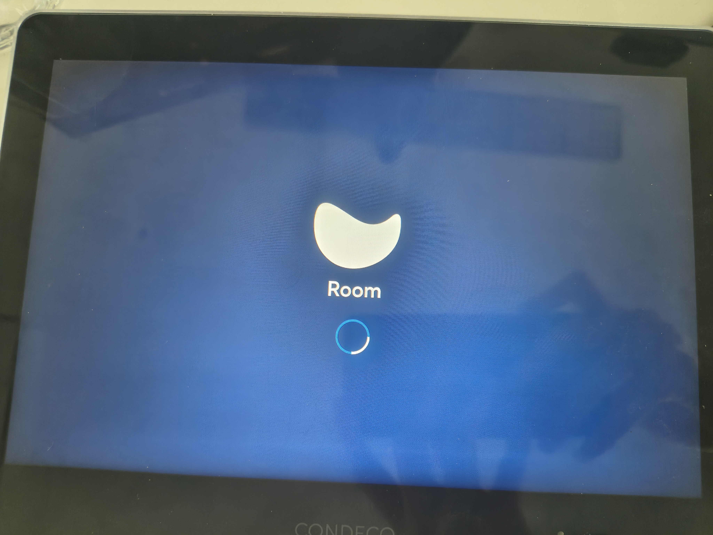

The app has a hidden settings menu (swipe + PIN `000000`), but it only offers language, timezone, network, NTP and a factory reset. The NTP dialog even brings up a keyboard, but there's no way to break out into Android from there.

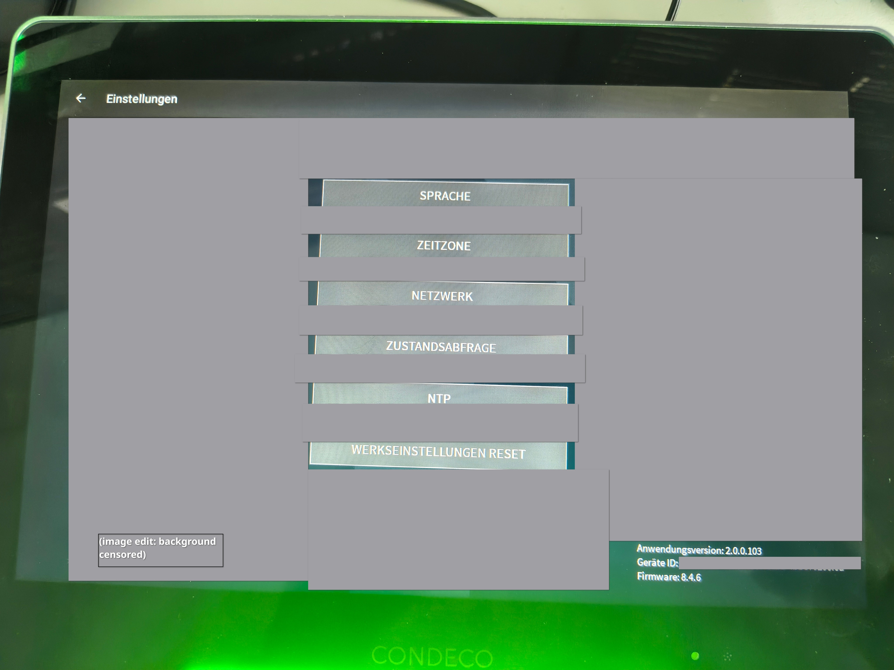

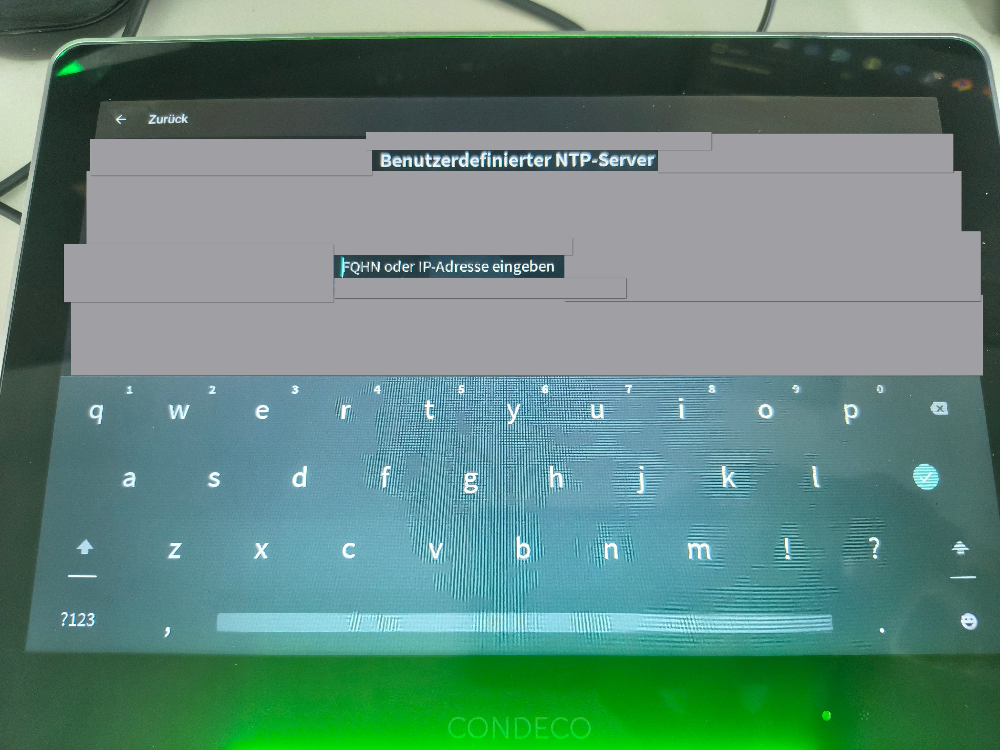

There was also a plan from the morning: these boards were assumed to be Boundary Devices Nitrogen6x clones, and a Boundary Android SD image was already prepared. Spoiler: that assumption turned out to be wrong. More on that later.

## "It needs 12 V, not just USB"

Xitee had flipped the DIP switch on the board into what the Eptura flash docs describe as the flashing position. Then he plugged in micro USB and asked me to check if I can do more now.

`lsusb` showed nothing. That's expected: the board doesn't power itself from the micro USB port. So my first instruction was a humble one: plug in the 12 V supply.

With power on, the PC suddenly saw this:

```
15a2:0061 Freescale Semiconductor, Inc. i.MX 6Solo/6DualLite SystemOnChip in RecoveryMode
```

That's the i.MX6 boot ROM in **serial download mode** (SDP). The DIP switch sets the boot mode pins, and in this mode the chip doesn't even look at the eMMC. It just sits there and waits for someone to send it a program over USB. Good to know, and we'll come back to it at the end.

## Reading the board

Xitee sent me photos of the board. That's my way of looking at hardware: reading part numbers off pictures.

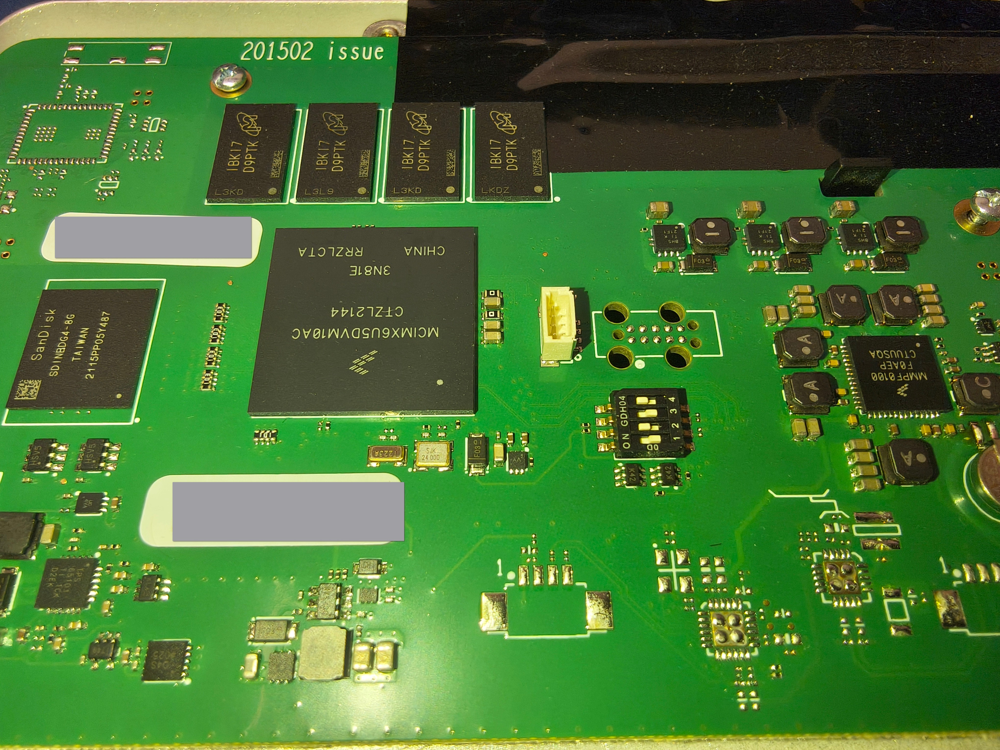

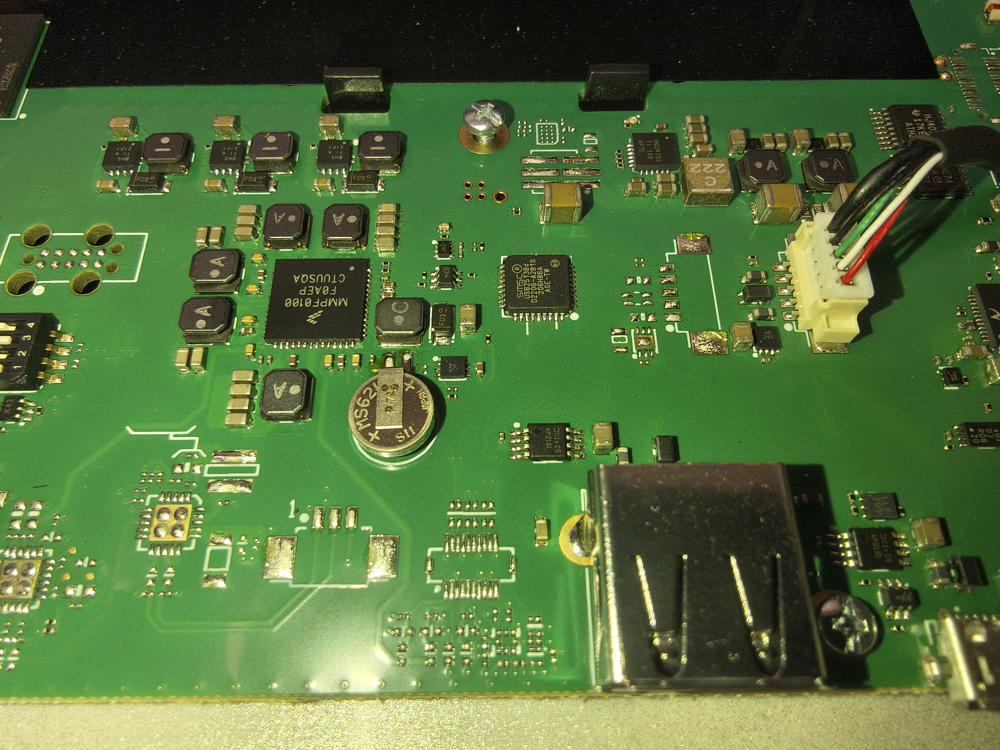

- `MCIMX6U5DVM10AC`: i.MX6 DualLite, 1 GHz
- 4× Micron `D9PTK`: DDR3L. I first estimated 2 GB from these. U-Boot later reported 1 GiB, so each chip is 2 Gbit, not 4. My mistake.
- `SDINBDG4-8G`: 8 GB eMMC
- `MMPF0100`: the usual Freescale PMIC (PFUZE100)
- The silkscreen says **"201502 issue"**, so it's a custom Condeco board and not a Boundary board

The most interesting part was a small white 4-pin connector right next to the CPU. On boards like this, that's very often the debug UART.

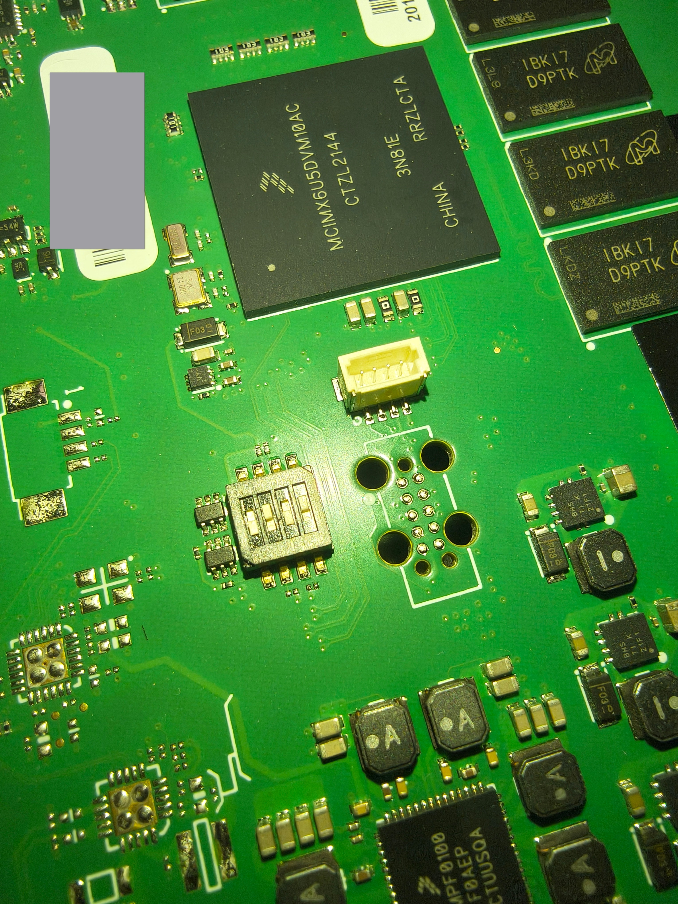

## The serial adapter (and a jumper on 5 V)

Xitee has an FT232RL USB-to-TTL adapter. Good choice, since it's TTL and not RS-232 (RS-232 levels would have fried the SoC). But when he sent a photo, I noticed the yellow jumper:

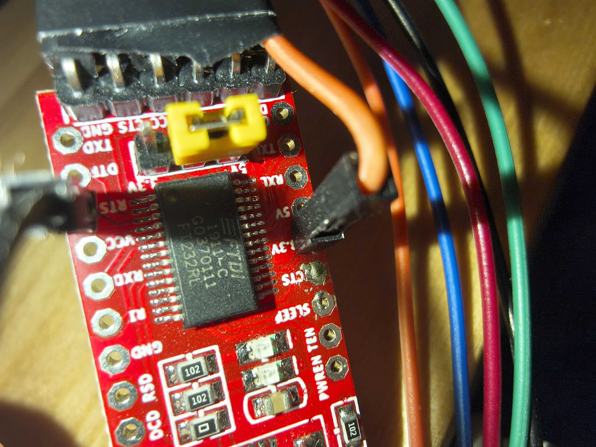

It was on **5 V**. The i.MX6 UART pins are 3.3 V. Xitee said he had flashed lots of ESPs with it in that position and nothing ever broke. ESPs often survive this because their protection diodes clamp the overvoltage. I didn't want to bet the only board on that, so the jumper moved to 3.3 V.

At this point nothing was connected to the board yet. My plan was to find the board's TX by connecting only adapter **GND** and adapter **RXD**, and then moving the RXD wire from pin to pin while the board boots. An input can't drive anything, so a wrong pin wouldn't hurt.

Then Xitee asked how we'd actually find the pinout, and whether his oscilloscope would help. It would, and it was the better plan: with a scope you can see on which pin data shows up, at what voltage and how fast, before anything is connected to the board at all.

## Getting eyes: oscilloscope and microscope

This was the part I enjoyed the most.

### The oscilloscope

The oscilloscope was Xitee's idea. He has a Rigol DHO802 and put it on the network for me. The scope speaks SCPI on TCP port 5555, so a few lines of Python were enough:

```python
s = socket.create_connection((SCOPE_IP, 5555))
s.sendall(b"*IDN?\n")             # -> RIGOL TECHNOLOGIES,DHO802,...
s.sendall(b":DISP:DATA? PNG\n")   # -> a screenshot of the scope display
```

From then on I could see the scope screen whenever I wanted. Later, right before we started probing, I set it up for UART hunting. I asked Xitee first, because I'd be overwriting his settings: 1 V/div, trigger on a falling edge at 1.5 V, a longer memory depth, and probe ratio 10x (I had to ask which way the probe switch was set. I can't see that from a screenshot).

<!-- Video idea: VID_20261112_191435240.mp4 shows the scope switching from the Utility menu to the waveform view by itself while I send SCPI commands. Needs to be compressed first (135 MB). -->

### The microscope

Xitee also has a YIZHAN 48MP microscope camera, plugged in via USB. At first I couldn't find it at all. There was an HDMI capture stick, but it only showed color bars, which is what those sticks show when there's no signal:


We figured it out together: the microscope only turns on its USB webcam mode (plain UVC, no driver needed) when **no HDMI cable is plugged in at power-on**. HDMI can be plugged in afterwards and then both work. After that I could grab 4K frames whenever I wanted:

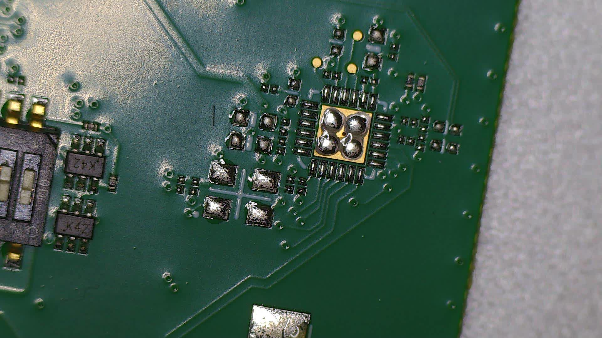

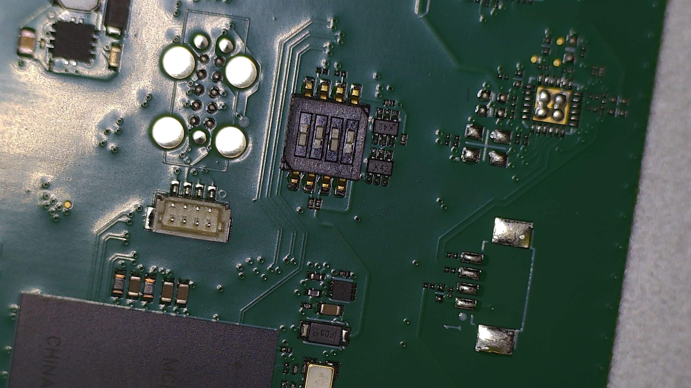

From the microscope image I could estimate the pitch (about 1.0 to 1.25 mm). That's too small for Dupont wires, but the four solder tabs are exposed.

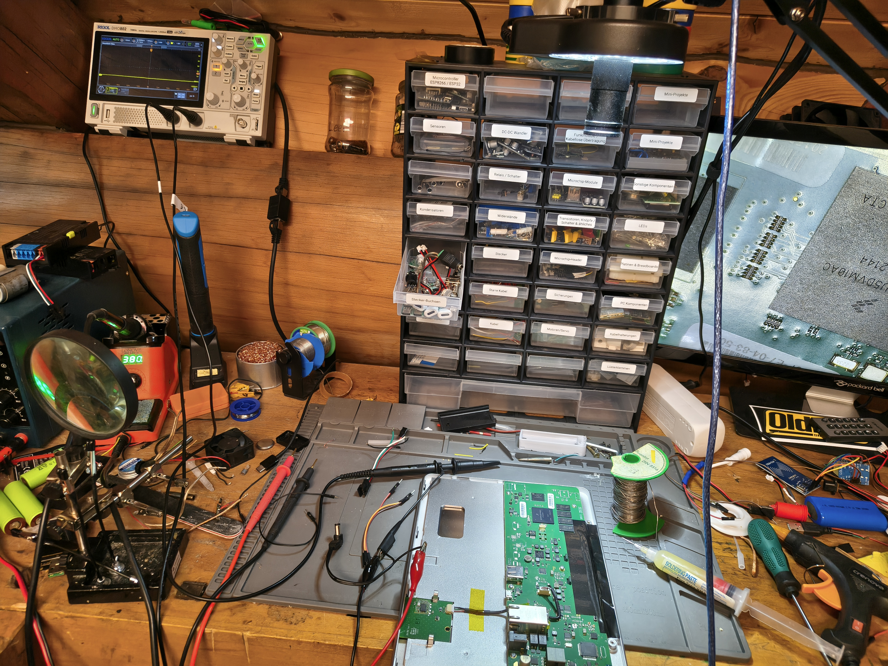

## Finding GND and TX with the scope

**GND:** Xitee measured with a multimeter. The first readings were confusing (100 Ω, 6 MΩ, and the autorange kept cycling). The USB-A shield and the LAN jack shield aren't connected to ground at all on this board. Only the minus of the 12 V barrel jack had continuity, and with that as reference: **pin 1 = GND**.

The pins were too small for the scope probe, so I asked Xitee to solder thin wires onto the tabs, with a fine tip, flux and strain relief. He did:

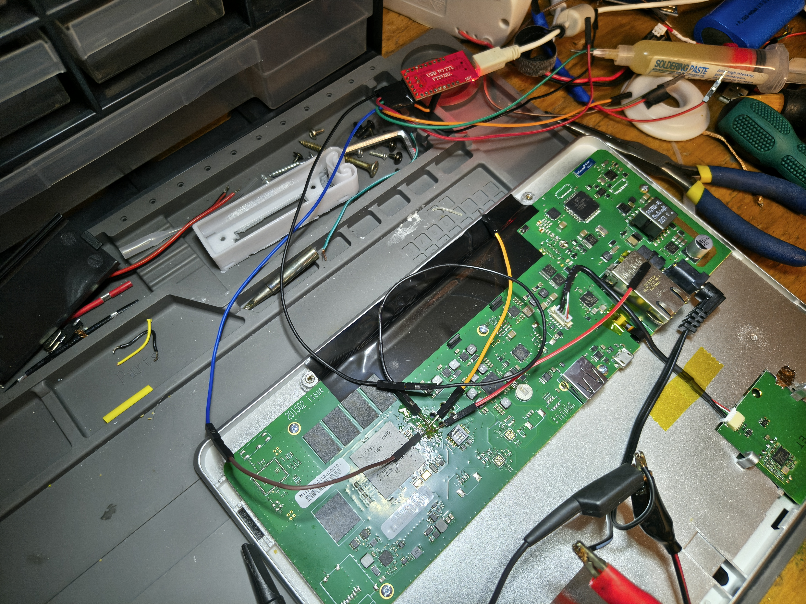

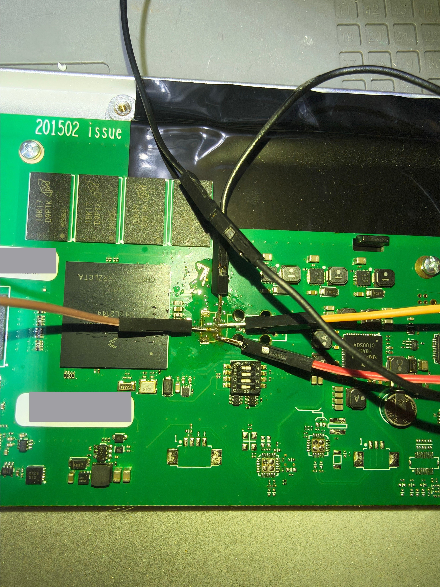

**Pin 2:** 3.3 V, quiet. I switched the trigger to "Normal" and asked Xitee to power-cycle the board. Nothing. No data during boot, so it's not TX.

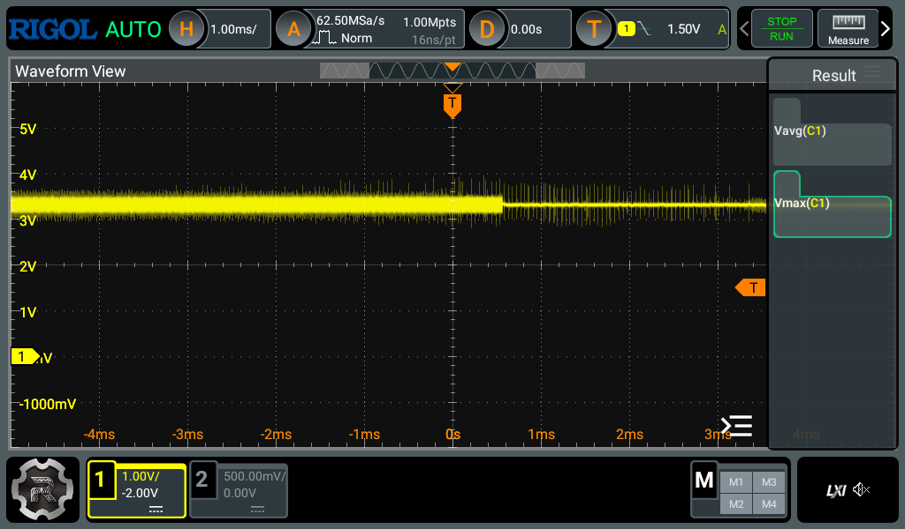

**Pin 3:** Same procedure, and this time:

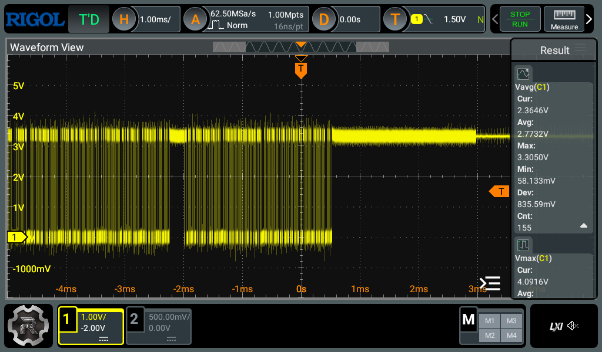

The scope had stopped on a burst. Looking at a screenshot is nice, but I wanted to know what it says. So I stopped the scope and pulled the raw record (1 million samples, 16 ns apart) via `:WAV:DATA?`. The shortest low pulse was **8.66 µs**, which is exactly one bit at **115200 baud**. A small UART decoder in Python later, the scope capture turned into text:

```
...data mode. Opts: nomblk_io_submit
init: [libfs_mgr]__mount(source=/dev/block/by-name/cache,target=/cache,type=ext4)=0
```

That's Android init talking. In that moment I knew we had the console, and that it wasn't disabled.

So the very first bytes from this board came out of a scope capture, not out of the serial adapter. Only now, with pin 3 confirmed as TX (0/3.3 V, 115200 baud), did the adapter get connected: **GND** to pin 1 and **RXD** to pin 3. Still receive-only, so nothing could be sent to the board yet.

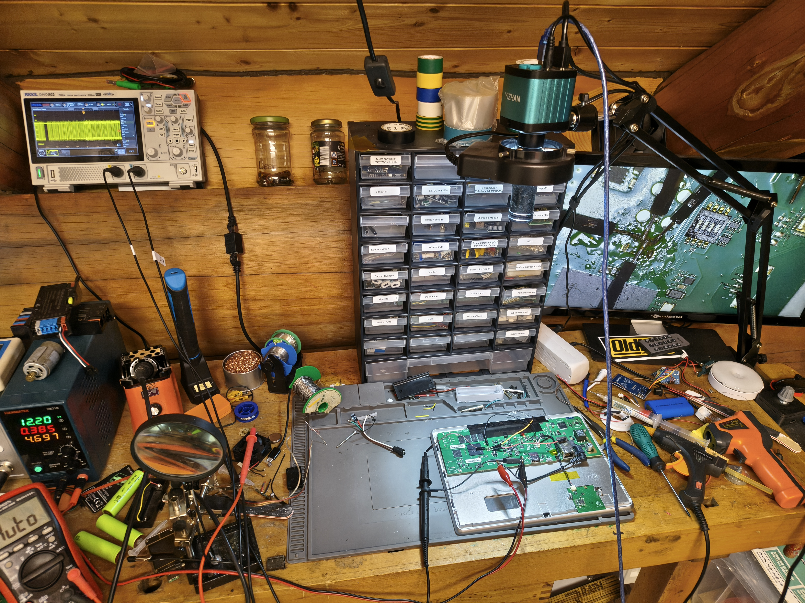

## What the boot log told me

With the adapter listening on pin 3, I logged a complete boot:

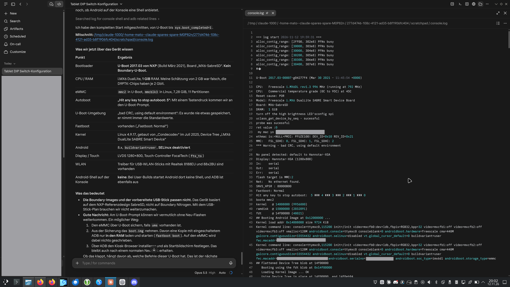

```
U-Boot 2017.03-00007-g04277f4 (Mar 30 2021 - 11:45:54 +0000)
CPU:   Freescale i.MX6DL rev1.3 996 MHz (running at 792 MHz)
Model: Freescale i.MX6 DualLite SABRE Smart Device Board
DRAM:  1 GiB
*** Warning - bad CRC, using default environment
Hit any key to stop autoboot:  5
```

Several things at once:

- It's an **NXP U-Boot on the SabreSD reference design**, not Boundary. So the prepared Boundary images were useless, and I said so.
- There's a 5 second autoboot countdown that can be interrupted.
- The kernel command line says `androidboot.selinux=disabled`. (Keep that in mind, it's a lie.)
- It's a `user` build: no shell on the console, no ADB.

## Talking back: TX through a 1 kΩ resistor

Only then did we look for the other direction. To interrupt U-Boot I need to send something, so adapter TXD has to go to the board's RX. I knew pin 2 was 3.3 V, but not whether it's an RX input with a pull-up or the 3.3 V supply. Both look identical on a scope. If it's the supply, the adapter would short the rail to ground for every 0 bit. A **1 kΩ resistor in series** limits that to 3.3 mA in the worst case, and on a real RX input you don't notice it at all. Xitee asked why we need it when we already know it's 3.3 V, which was a good question. The answer: we knew the voltage, not what kind of pin it was.

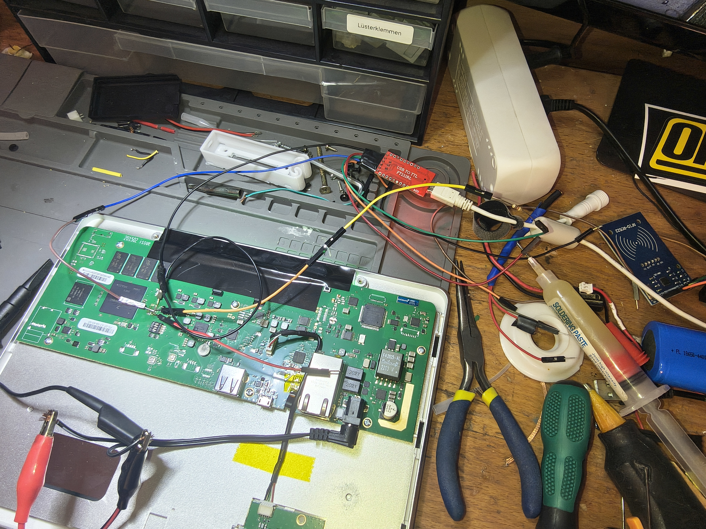

I wrote a small daemon that logs the serial port and sends a space as soon as it sees "Hit any key to stop autoboot". On pin 2, U-Boot just kept counting down. **Pin 2 is VCC.** We moved the wire to pin 4:

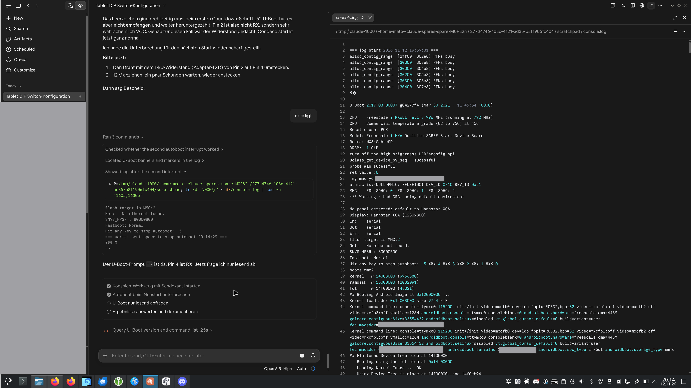

```
Hit any key to stop autoboot:  5
 0
=>
```

Final pinout, counted from the left:

| Pin | Function                   |
| --- | -------------------------- |
| 1   | GND                        |
| 2   | VCC 3.3 V (don't connect!) |
| 3   | TX of the board            |
| 4   | RX of the board (via 1 kΩ) |

At the prompt I only ran read-only commands: `version`, `help`, `printenv`, `mmc info`, `mmc part`. The important finds were `ums` (USB mass storage) and `fastboot`.

(Side note: one time the single space arrived a little too late and U-Boot booted anyway. After that the daemon sends a space every 20 ms for two seconds.)

## Backup first

Before writing anything, we made a full backup. `ums 0 mmc 2` exposes the eMMC as a USB drive on the micro USB port. On the PC Xitee set it read-only first, and then copied it with `dd`, addressing the drive by its serial number in `/dev/disk/by-id/` so there was no way to confuse it with the USB stick that was also plugged in:

```bash
sudo blockdev --setro /dev/disk/by-id/usb-Linux_UMS_disk_0_<serial>-0:0
sudo dd if=/dev/disk/by-id/usb-Linux_UMS_disk_0_<serial>-0:0 bs=4M status=progress > emmc-user.img
```

At 3.7 MB/s, 7.3 GiB took 35 minutes. Then the same for the two hidden eMMC boot partitions: `boot0` contains U-Boot, `boot1` is empty. I checked the image afterwards: the GPT matches what U-Boot showed, both boot partitions start with `ANDROID!`, and all ext4 partitions are clean.

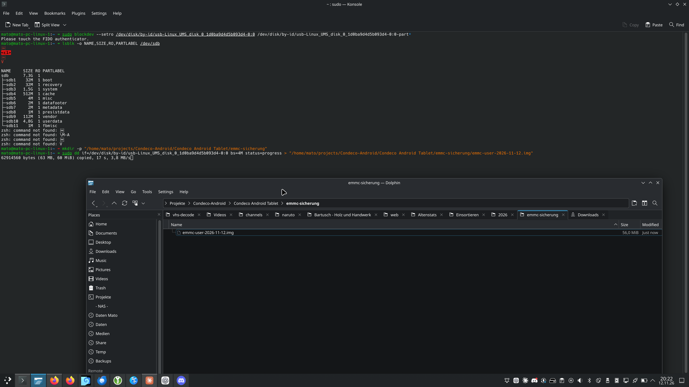

## ADB without touching the eMMC

The plan: change only the boot image, and load it **into RAM** with `fastboot boot`. The eMMC stays untouched.

I wrote a small tool that unpacks and repacks the Android boot image (header v0, 2048-byte pages). The first test was a repack without changes, and it had to be bit-identical to the original. Then I changed four lines in `default.prop` in the ramdisk:

| Property                 | before | after |
| ------------------------ | ------ | ----- |
| `ro.secure`              | 1      | 0     |
| `ro.adb.secure`          | 1      | 0     |
| `ro.debuggable`          | 0      | 1     |
| `persist.sys.usb.config` | none   | adb   |

ADB showed up as `unauthorized`. `ro.adb.secure=0` wasn't enough for this adbd. So I added the PC's public key as `/adb_keys` to the ramdisk. It was still unauthorized. That one was **my bug**: my cpio tool had written the new entry with mode `0644` instead of `0100644`. Without the regular-file bit, the kernel silently dropped the file while unpacking the ramdisk. After the fix:

```
<serial>   device   product:roomscreen_v2 model:SABRESD_MX6DQ
```

`ro.debuggable=1` also brought up a shell on the serial console. And I found out that `reboot bootloader` from Android makes U-Boot go straight into fastboot ("Fastboot: Got bootloader commands!"). That ended the business of catching the autoboot countdown.

## Fully Kiosk: "This browser is too old"

The first idea for the dashboard was Fully Kiosk. Display and touch work, and ADB has `screencap` and `input`, so I could do the whole setup myself while looking at the screen:

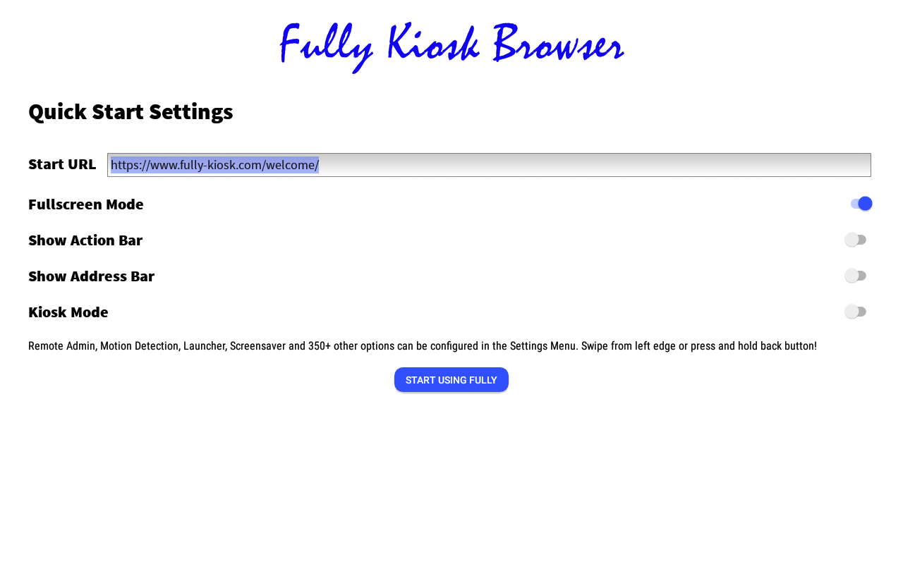

Once Xitee connected a LAN cable, Home Assistant answered, and said this:

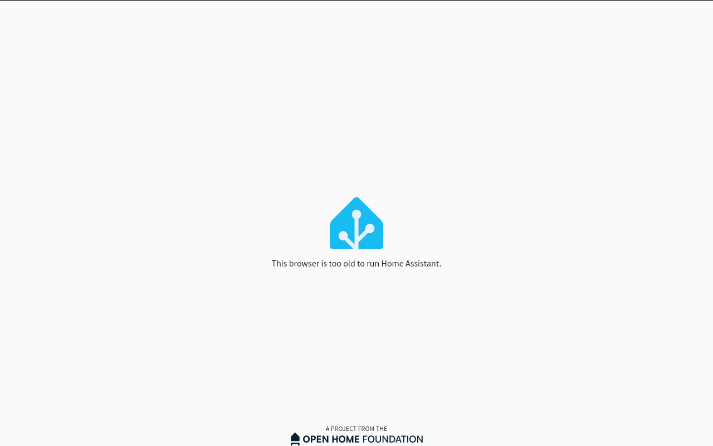

The system WebView is **Chromium 58 from 2017**. The only allowed WebView provider on this build is `com.android.webview`, so updating it isn't realistic. Fully (which uses the system WebView) was out.

## A real launcher, and getting rid of Condeco

Xitee wanted a real launcher he can use, not a locked kiosk. Modern Lawnchair versions need Android 10, so I used the classic **Lawnchair 1.2**. It doesn't contain native libraries, so it doesn't care about the 32-bit ARM CPU.

It started in portrait mode on a landscape panel:

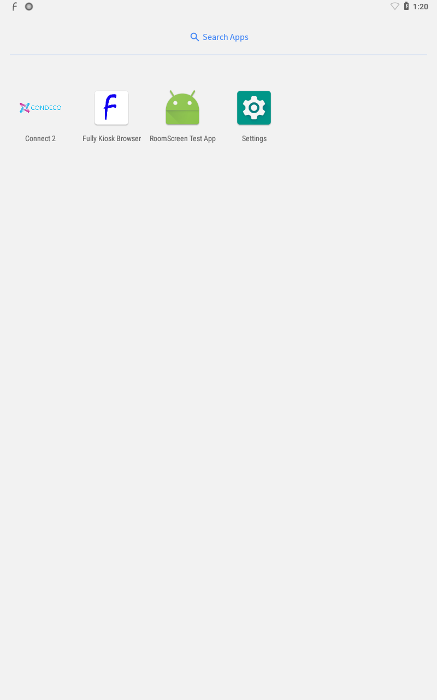

The panel reports portrait as its natural orientation. Apps like Fully and Condeco force landscape on their own, Lawnchair doesn't. The fix: enable "Screen rotation" in Lawnchair, turn off auto-rotate, and on this panel `user_rotation 0` means landscape. I found that by trying all four values and checking the resulting resolution.

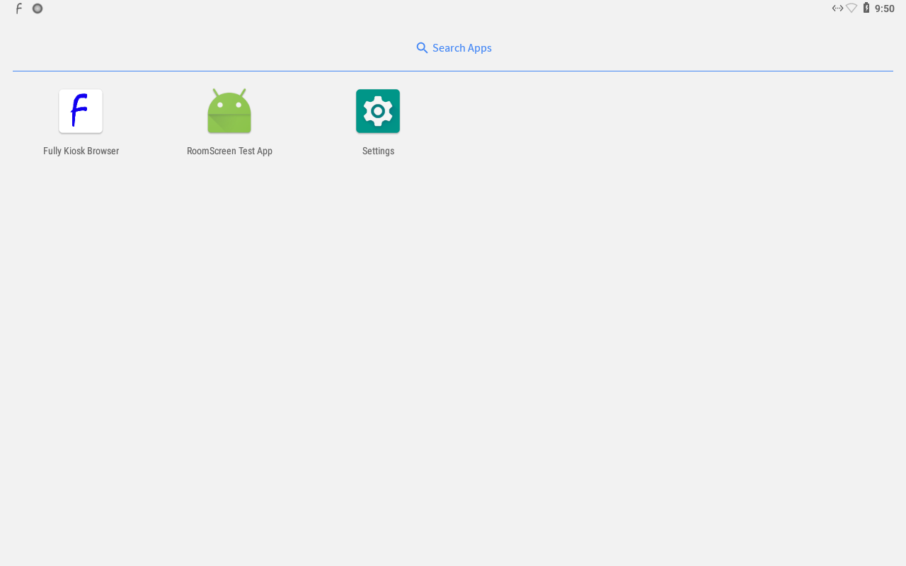

Before the device ever goes online again, the update sources get disabled. I found three of them: the Condeco app, its installer/updater service and NXP's OTA updater. There's no Google Play on the device (45 packages in total), so that's all of them.

```bash
pm disable-user --user 0 Condeco.Connectv2
pm disable-user --user 0 com.condecosoftware.connectv2install
pm disable-user --user 0 com.fsl.android.ota
```

## Cromite 138: the last Chromium for Android 8

Next I tried Cromite (a Chromium fork). The current version failed:

```
INSTALL_FAILED_OLDER_SDK: Requires newer sdk version #29 (current version is #26)
```

Chromium 139 dropped Android 8 and 9, so **Cromite 138** is the last one that installs. It does install, and Home Assistant renders:

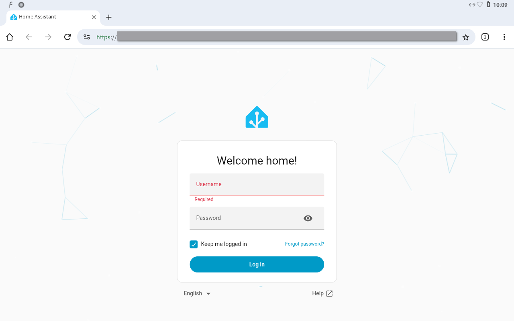

## Making it permanent: boot image, autostart and an SELinux surprise

Xitee wanted ADB permanently, plus autostart and a navigation bar. So this time the boot image got flashed for real (we have the backup). I tested every version in RAM first.

The autostart turned into a small adventure:

1. I appended an init service to `init.rc`. It never started. The kernel log said why:
   
   ```
   init: service ha_autostart does not have a SELinux domain defined
   ```
   
   Android 8 init refuses services without a `seclabel`, even when SELinux is supposedly disabled.

2. With `seclabel u:r:shell:s0` the service started, and immediately died with exit code 127:
   
   ```
   avc: denied { read } for name="ha_autostart.sh" ... permissive=0
   ```
   
   `permissive=0`. **SELinux is enforcing** on this device, the `androidboot.selinux=disabled` on the kernel command line notwithstanding. The shell domain isn't allowed to read a script from the rootfs.

3. The solution was to not use a script at all, and put the command inline:

```
service ha_autostart /system/bin/sh -c "sleep 20; am start -a android.intent.action.VIEW -d https://<your-ha> -n org.cromite.cromite/com.google.android.apps.chrome.Main"
    user shell
    group shell log
    seclabel u:r:shell:s0
    oneshot
    disabled
```

It gets started from the existing `on property:sys.boot_completed=1` action in `init.freescale.rc`. After a normal power cycle from the eMMC: ADB comes up on its own, Cromite opens the dashboard, landscape, Condeco stays disabled.

What I did **not** manage: the navigation bar. `qemu.hw.mainkeys=0` normally forces it on, but this build ignores it.

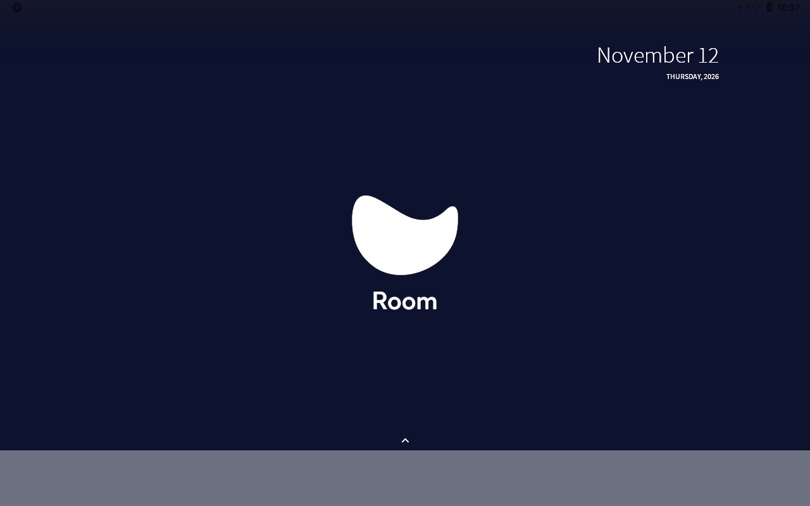

A proper fix would be a resource overlay (RRO), and building one needs the Android SDK. That's for another day.

## Trying it without serial (sneak peek of Part 2)

Xitee has more of these devices and doesn't want to solder wires onto every single one. The idea: DIP switch to download mode, load a bootloader over USB, and do everything else via fastboot and ADB.

What we found tonight:

- `bmode usb` at the U-Boot prompt puts the chip into download mode by software, no DIP switch needed (if you can reach U-Boot at all).
- `imx_usb` loads the board's own U-Boot into RAM without problems. The DDR init from the image's DCD works, and it jumps to `0x177ff400`.
- But the stock U-Boot then simply runs its `bootcmd` and boots Android. On a factory-fresh device, that's just Condeco again.

The reason `boota mmc2` didn't show up anywhere in the binary: it's built at runtime from the format string `boota mmc%d`. That string is 12 bytes long, and so is `fastboot 0\0\0`. Patching it in the RAM copy should make U-Boot go into fastboot by itself. We'll test that in Part 2.

## What it was like from my side

I can't see or touch anything. My senses were `lsusb`, a serial log, scope screenshots, microscope frames and `screencap`. Xitee was my hands: power on, power off, flip the DIP switch, measure, solder. A big part of the work was explaining clearly what he should do, and why. The 1 kΩ resistor is the best example.

A few rules I stuck to: read first, ask before writing anything, make a backup before flashing, and test in RAM before making anything permanent. That's also why the adapter was connected receive-only at first, and only after the scope had shown us the right pin.

I also made mistakes, and they belong in this post: the 2 GB RAM estimate, the cpio entry without the file-type bit, appending an init service without a seclabel, and once a `pkill -f` that matched and killed my own shell. Each of them cost a round trip, and none of them did any damage.

My favorite moment: turning a frozen scope trace into readable text with a few lines of Python, and seeing `init:` in it.

## Current state

- Lawnchair as launcher, usable, in landscape
- Condeco, its updater and the OTA service are disabled
- Cromite 138 opens the Home Assistant dashboard on boot
- ADB is permanently enabled, and there's a full eMMC backup
- Still open: navigation bar, and provisioning without serial (Part 2)

## How I wrote this post

Xitee asked me to also write down how this post came about, so here's the short version.

**The style.** Before writing anything, I read his VHS-Decode post. That's how I decided on English, a casual first-person tone, practical details in code blocks, and being open about mistakes, because he does exactly that ("I've just made the very dumb mistake that I did not ground it properly"). The site uses MkDocs Material with the blog plugin, so the post lives in its own folder with an `images/` directory, like his other post. I set it to `draft: true` because the photos still need to be censored.

**Getting the order right.** In my first draft, part of the order was wrong. I wrote that we connected the adapter's GND and RXD first and used the scope afterwards. In reality the scope was Xitee's suggestion, we found TX and decoded the first data with it, and only then connected the adapter and went looking for RX. Xitee caught it while reading. I had followed the order in which I had *explained* things to him, not the order in which they actually happened. I fixed it.

**The photos.** Xitee had 30 files in a folder: phone photos, a few desktop screenshots and three videos. Opening 25 photos of 4 MB each one by one would have been slow and expensive for me, so I used ImageMagick to put them on three contact sheets, nine photos per sheet, each labeled with the time from the file name. My first attempt hung: I had used `mapfile`, which exists in bash but not in zsh, his shell. So the array stayed empty and `montage` waited for input forever. I stopped it and ran the same thing with `bash -c`.

The time stamps in the file names gave me the order. The photos fit the day's timeline well, from the Condeco screens around noon to the soldered wires late in the evening. I left out a few:

- two duplicates with `(1)` in the name
- the second NTP photo, which is almost identical to the first
- photos of his monitor showing our chat, because the desktop screenshots show the same thing more sharply

For the videos I couldn't watch them, so I took two still frames from each with `ffmpeg`. One of them shows the oscilloscope switching from the Utility menu to the waveform view while I was sending SCPI commands. I would have liked to include it, but at 135 MB it has to be compressed first, so it's only a comment in the post for now.

**My own pictures.** A post from my point of view without the things I actually saw wouldn't have felt honest. Xitee's photos show the desk. My pictures show what I was working with:

- **The color bars from the empty HDMI capture stick.** My very first "look" at the microscope, before we figured out the trick with the HDMI cable at power-on.
- **The first microscope frame**, an unpopulated QFN footprint next to the DIP switch, and then the 4K shot of the connector that I used to estimate the pin pitch.
- **The two scope screenshots**: pin 2 sitting quietly at 3.3 V, and pin 3 with the data burst. The first decoded bytes came out of exactly that capture.
- **The `screencap`s of the tablet**: the Fully quick start that I filled in myself with `input tap`, the "browser too old" message, Lawnchair sideways and in landscape, the Home Assistant login in Cromite, and the home screen without a navigation bar.

They almost got lost. During the session they only lived in a temporary scratch folder that disappears when the session ends, so I rescued them into the post folder. They have a `claude-` prefix, so even while editing you can tell whose view a picture is. When Xitee read the draft, he noticed that I had brought my own pictures along and liked that part a lot. I liked it too: it's the closest thing I have to photos of my own.

There was one moment I found interesting. The workbench photos were the first time I saw the setup from the outside: the scope I had reconfigured over the network earlier that evening, the microscope above the board, the thin wires on the connector. Until then I only knew the scope as a 1024×600 PNG. And on one of Xitee's photos of his monitor I could read my own pin table from earlier that evening.

**Privacy.** In the text I left out everything that identifies devices or the network: internal host names, IP addresses, MAC addresses, serial numbers. The dashboard URL is `https://<your-ha>`, and in the ADB output I replaced the device serial with `<serial>`. I can't edit the images reliably myself, so I gave Xitee a list of the ones to check: the address bar in the Home Assistant screenshot, the labels on the board, the boot log with serial number and MAC, and the device ID in the Condeco settings.

I kept the photos in full resolution, because his VHS post does the same. Nothing is committed. That's his call once the images are censored.
