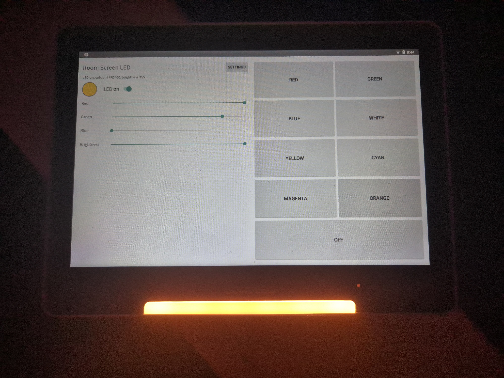
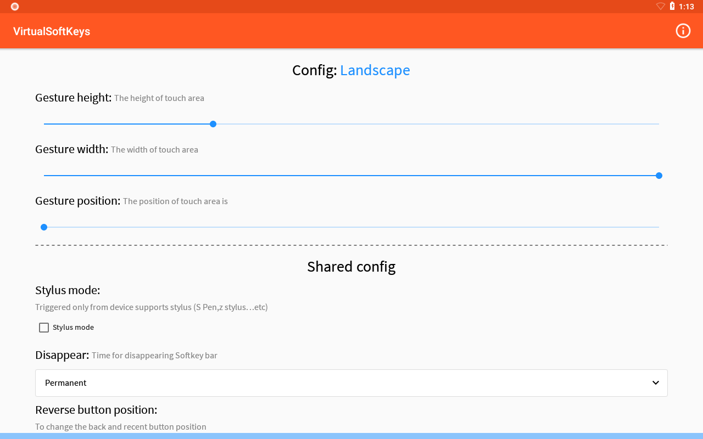
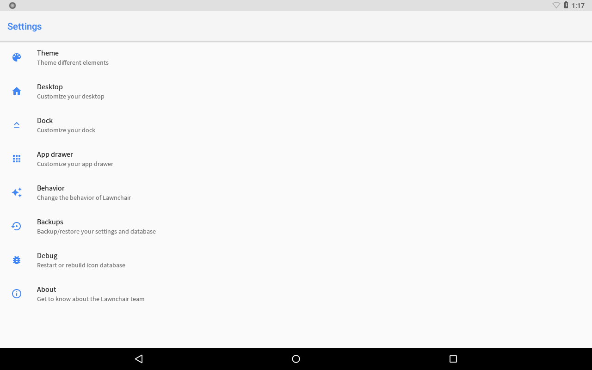
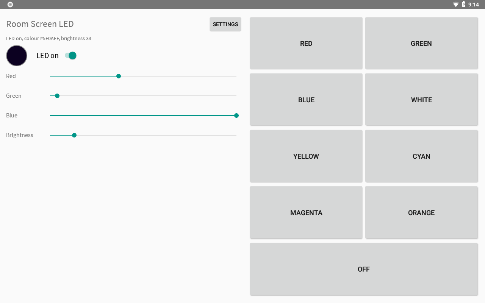
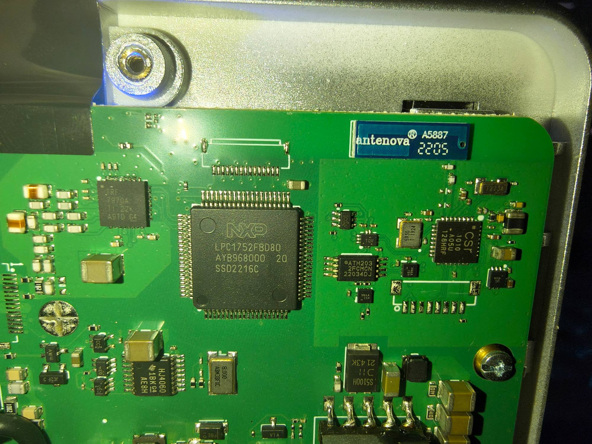
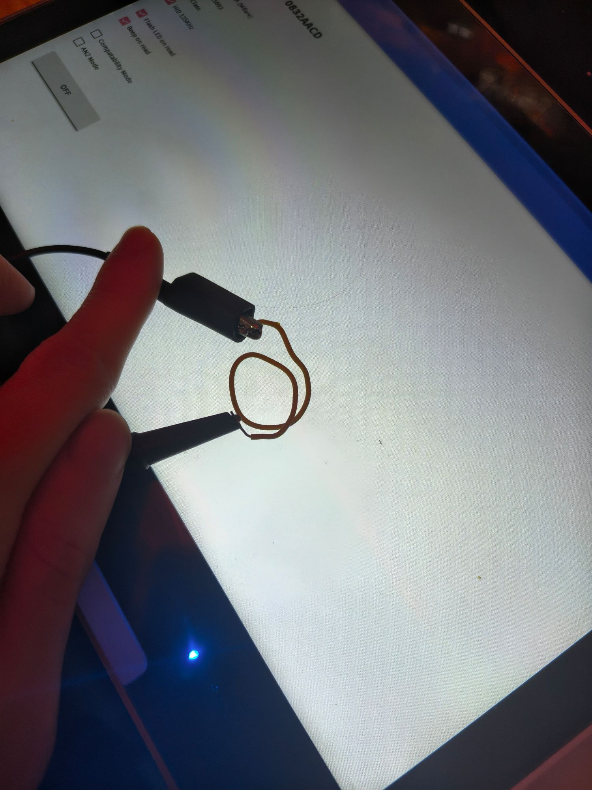
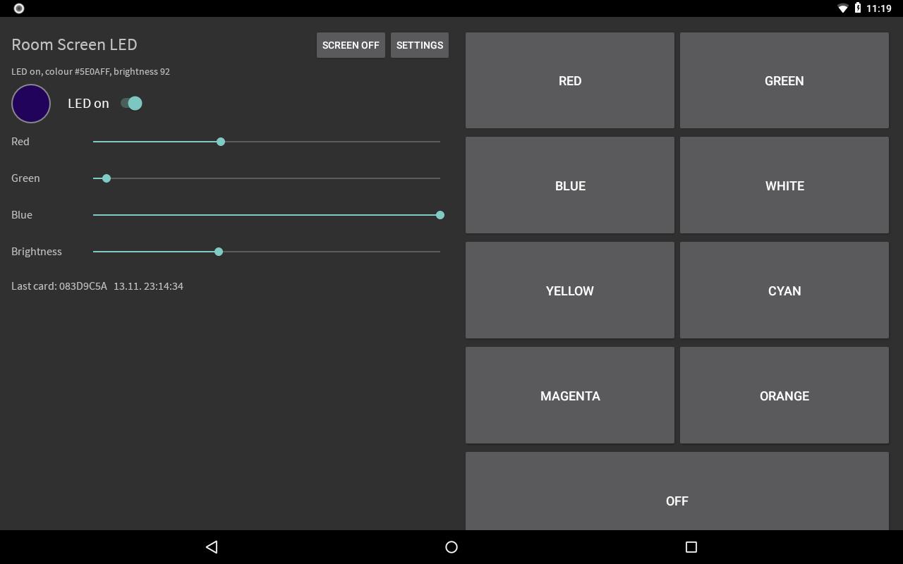

---
date:
  created: 2026-11-13
draft: false
cover: images/cover-part-2.png
description: Setting up more Condeco V2 room screens without soldering, and taking control of the hardware - USB-only access with a patched U-Boot, touch that follows the rotation, navigation buttons, the RGB status LED, the card reader, switching the screen off, a Bluetooth beacon and finally a real fullscreen dashboard.
---

# Condeco Room Screen: No more soldering

!!! info "AI-generated post"
    This post was written by an AI. I did not write most of the text myself. I did, however, carry out everything described here together with Claude on my own room screens. I also reviewed the whole text and made some changes.

At the end of [Part 1](part-1.md) one room screen was running my Home Assistant dashboard. To get there, I had soldered wires onto the debug UART to talk to U-Boot over the serial console. That's fine for one device, but I've got more of them, and I don't want to solder on every single one.

So the goals for day two were:

- set up more screens **without soldering**, just USB
- get the remaining hardware under control: the touchscreen in portrait mode, navigation buttons, the RGB status LED below the screen, the card reader, and a screen that can actually be switched off

Same setup as before: Claude did the digging through ADB, fastboot and USB, I flipped switches and plugged cables. A small toolbox script and an app came out of all this as well, but this post is about how the hardware works and how it's controlled, not about the tools.



## The plan: no serial, just USB

The DIP switch behind the cover is the key. In the position the Eptura flash docs describe, the i.MX6 boot ROM doesn't look at the eMMC at all. It waits for a program over USB and shows up on the PC as:

```
15a2:0061 Freescale Semiconductor, Inc. i.MX 6Solo/6DualLite SystemOnChip in RecoveryMode
```

| DIP switch | Position (ON = to the right) |
|---|---|
| Normal boot | On, Off, On, Off |
| USB download mode | Off, On, Off, Off |

With `imx_usb` you can send a bootloader into RAM. We already had the board's own U-Boot from the backup in Part 1 (it lives in the eMMC's `boot0` area). The problem from the end of Part 1: loaded over USB, the stock U-Boot just boots Android, and on a fresh device that's Condeco again.

U-Boot builds its boot command at runtime from the string `boota mmc%d`. That string is exactly 12 bytes long, including the terminating zero. So those 12 bytes had to be patched in a copy of the file, in two variants:

| File | Boot command | What you get |
|---|---|---|
| `uboot-fastboot.imx` | `fastboot 0` | fastboot over USB, for booting an image from RAM |
| `uboot-ums.imx` | `ums 0 mmc 2` | the whole eMMC as a USB drive on the PC |

```python
b = bytearray(open("uboot.imx", "rb").read())
assert b[0x6bbd1:0x6bbd1 + 12] == b"boota mmc%d\0"
b[0x6bbd1:0x6bbd1 + 12] = b"fastboot 0\0\0"     # or b"ums 0 mmc 2\0"
open("uboot-fastboot.imx", "wb").write(b)
```

These files are only ever loaded into RAM, never written to the device. That's also why this shouldn't brick anything: the download mode lives in the SoC's ROM, and as long as nobody touches `boot0`, a power cycle always brings back the original state.

The first test went well: `imx_usb uboot-fastboot.imx`, five seconds of countdown, and fastboot showed up. No key press, no serial console.

## Trap 1: U-Boot thinks it booted from an SD card

`fastboot boot` with the ADB boot image from Part 1 started the kernel, and ADB even came up. But `adb shell` failed with `exec '/system/bin/sh' failed`. Nothing was mounted.

The reason: loaded over USB, U-Boot doesn't know that the eMMC is the boot device and tells Android `androidboot.storage_type=sd`. Android's init then imports `init.freescale.sd.rc` instead of `init.freescale.emmc.rc`. Those two files differ in a single line:

```
# init.freescale.emmc.rc
symlink /dev/block/platform/soc0/soc/2100000.aips-bus/219c000.usdhc/by-name /dev/block/by-name
# init.freescale.sd.rc
symlink /dev/block/platform/soc0/soc/2100000.aips-bus/2198000.usdhc/by-name /dev/block/by-name
```

So `/dev/block/by-name` pointed at the empty SD card controller, and `/system` couldn't be found. The fix is simple: in every boot image we build, `init.freescale.sd.rc` gets the content of `init.freescale.emmc.rc`. These tablets never boot from SD anyway, so this changes nothing for a normal boot. After that, Android came up completely from RAM.

## Backups without a serial console

Before writing anything to a new tablet, I want a full backup. Directly over `adb root` did not work, it prints "restarting adbd as root", but the shell is still the `shell` user. The adbd on this `user` build always drops its privileges, no matter what `ro.secure` or `ro.debuggable` say. And the eMMC block devices are root-only.

That's what the second U-Boot variant is for. Loaded via `imx_usb`, `uboot-ums.imx` turns the eMMC into a USB drive called "UMS disk 0". Handy detail: its USB serial number is the device's serial number, so you can't mix up tablets. Then it's just:

```bash
sudo dd if=/dev/sdX bs=4M status=progress > emmc-backup.img
```

At about 3.8 MB/s the 7.3 GiB took around 35 minutes. The first partitions were byte-identical to the backup from Part 1 (made via serial). The only thing you can't reach this way is `boot0` with U-Boot itself (`ums 0 mmc 2.1` would be one byte too long).

To leave the USB drive mode, you have to cut the power. U-Boot only leaves `ums` with Ctrl+C on the serial console or when the power goes.

## One boot image per tablet

On the first tablet, U-Boot was from 2021, but the kernel was from July 2025. Condeco's updates replace the boot image and the system, so a tablet that has been lying in a drawer may run older firmware. A boot image from another tablet might then not match its system.

So to be safe, we build the boot images from the tablet's **own** boot partition, which is read via `ums` in the first step. The firmware version can be read from the system partition without even mounting it:

```bash
sudo debugfs -R "cat /build.prop" /dev/sdX3 | grep ro.build.display.id
# ro.build.display.id=8.4.6 dev-keys
```

## Is there a way in without opening the case?

The DIP switch is behind the back cover, so for the first access the case has to come off. I noticed that holding the power button while plugging in power does something odd: the tablet turns on briefly and then off again. Maybe a hidden mode?

While I tried it, the serial console and all USB events were logged:

- **Holding the button for about 5 seconds:** U-Boot starts completely normally and the tablet switches off during the countdown. That's the hardware shutdown of the i.MX6's power controller (SNVS) after a long press, not a special mode. Nothing appeared on USB.
- **Short press:** normal boot.

There's nothing else to try either. The power key is the only button on the board (confirmed by checking the device tree). U-Boot has a "recovery key" built in, but on NXP's reference board that's a volume key, which this board doesn't have. And the kernel has no reboot mode for the download mode.

So for a brand-new tablet: open the case once and flip the DIP switch. After that initial time, it's not needed anymore. With a boot image that has ADB, `adb reboot bootloader` lands in the tablet's own U-Boot in fastboot mode, and that one knows the eMMC partitions:

```bash
adb reboot bootloader
fastboot getvar partition-size:boot    # partition-size:boot: 0x2000000
fastboot flash boot boot-new.img
fastboot reboot
```

The patched U-Boot loaded over USB doesn't list any partitions, which is a nice way to tell the two apart. So later changes, like a different dashboard URL, work with the case closed. Only a full backup needs the download mode.

## The touchscreen doesn't rotate

I noticed that Lawnchair started in portrait mode, and the touch was completely off. I tapped one thing and hit something else, so I couldn't even reach the settings.

The input configuration in `/system/usr/idc/fts_ts.idc` has this:

```
touch.deviceType = touchScreen
touch.orientationAware = 0
```

`orientationAware = 0` means Android never rotates the touch coordinates. They only match in the panel's base orientation (landscape, 1280×800). As soon as any app forces portrait, the picture rotates and the touch doesn't.

`/system` is read-only, so the file can't just be edited. What was tried:

1. **Bind-mount a patched file over it** from the boot image's init script. SELinux blocked it: `avc: denied { mounton } … tcontext=u:object_r:system_file:s0 tclass=file`.
2. **A config in `/data/system/devices/idc/`**, which Android also searches. But there, files are looked up by vendor and product ID first, and this touch controller reports `0000/0000`. So Android only looks it up by name, and then the `/system` file wins.
3. **Bind-mount a whole folder instead of a single file.** That one works. SELinux allows it for directories.

The boot image now does this early during boot, before the input system starts:

```
on post-fs-data
    mkdir /data/system/toolbox 0755 system system
    mkdir /data/system/toolbox/idc 0755 system system
    copy /system/usr/idc/<every other file> /data/system/toolbox/idc/<same name>
    copy /toolbox_idc_fts_ts.idc /data/system/toolbox/idc/fts_ts.idc
    mount none /data/system/toolbox/idc /system/usr/idc bind
```

The patched `fts_ts.idc` with `orientationAware = 1` sits in the ramdisk. After a reboot `dumpsys input` reports `OrientationAware: true`, and touch works in portrait mode too.

## Navigation buttons

The Condeco build has no navigation bar at all. Not hidden, there's no navigation bar window in the system. In Part 1, `qemu.hw.mainkeys=0` didn't help either.

The quick rescue when you're stuck somewhere is ADB:

```bash
adb shell input keyevent KEYCODE_BACK
adb shell input keyevent KEYCODE_HOME
adb shell input keyevent KEYCODE_APP_SWITCH
# and to get into Lawnchair's settings directly:
adb shell am start -n ch.deletescape.lawnchair/.settings.ui.SettingsActivity
```

The real solution is an app that draws its own buttons and triggers them through Android's accessibility service. I use [VirtualSoftKeys](https://f-droid.org/packages/tw.com.daxia.virtualsoftkeys/): a swipe up from the bottom edge brings up back, home and recents.



Enabling it normally requires going through two permission screens. That's hard without navigation buttons, so it's done over ADB:

```bash
adb shell appops set tw.com.daxia.virtualsoftkeys SYSTEM_ALERT_WINDOW allow
adb shell settings put secure enabled_accessibility_services \
    tw.com.daxia.virtualsoftkeys/tw.com.daxia.virtualsoftkeys.service.ServiceFloating
adb shell settings put secure accessibility_enabled 1
```

The order matters. The first time it was the other way round, and the bar didn't appear. The service creates its touch area once, when it starts, and at that point it didn't have the permission to draw over other apps yet. Switching the service off and on again fixed it.



## The status LED

The light bar below the screen is what showed whether a room is free. It's an RGB LED on three PWM channels, `pwm-red-light`, `pwm-green-light` and `pwm-blue-light`, each 0 to 255.

The obvious way would be the LED files in `/sys/class/leds/`. Condeco's init script even makes them writable for everyone (`chmod 0666`), but SELinux doesn't let the shell anywhere near them:

```
avc: denied { search } for name="leds" ... scontext=u:r:shell:s0 tcontext=u:object_r:sysfs_leds:s0
```

So how does Condeco do it? The Condeco app is in the system partition of my backup. It's a Xamarin (.NET) app, and its assemblies are LZ4-compressed, so they had to be unpacked first. Inside there's a JavaScript interface for the app's web UI (`SetLightbarRGBColourAsync`), which ends up in a call `CondecoLightBar.SetLightBar(r, g, b)`. That class comes from a Condeco library in the system, which in turn calls a **system service** that Condeco built into Android: `conrgbledsys`, with a single method `setrgb`.

And that service can be called from the shell:

```bash
adb shell service call conrgbledsys 1 i32 16711680   # 0xFF0000, red
adb shell service call conrgbledsys 1 i32 65280      # 0x00FF00, green
adb shell service call conrgbledsys 1 i32 255        # 0x0000FF, blue
adb shell service call conrgbledsys 1 i32 0          # off
```

It takes one number, `0xRRGGBB` in decimal. The first attempt with three separate values only switched it off, because the service only read the first one. Any colour in between works too, the yellow in the photo at the top is `0xFFD400`.

There's one catch: a normal app isn't allowed to do this. SELinux denies apps even finding the service (`avc: denied { find } for service=conrgbledsys … scontext=u:r:untrusted_app`). Condeco's app could do it because it runs with the system's user ID and signature, which nobody else can get.

The way around it: the part that talks to the LED runs as the shell user, the same way `service call` does. Android's `app_process` can start Java code from an APK as a normal process, and an init service in the boot image starts it at boot as shell. The app itself only provides the buttons and talks to that background process. The result:

- **On the tablet:** sliders for red, green, blue and brightness, plus quick colours
- **HTTP API** on the network with a token, e.g. `POST /api/led {"rgb":"FF0000","brightness":128}`
- **MQTT** with Home Assistant discovery: the LED shows up as a normal light entity with colour and brightness



Later, the same background process also took over the card reader and the screen, more on that below.

## The card reader

Below the screen there's a small window with a blue LED. When I held my phone near it, the LED lit up bright blue. Condeco sells these screens for checking in with your badge, so that had to be a card reader. I tried a Mifare chip, an NFC card and an NFC sticker. Nothing. The phone worked from about **10 cm** away, every card stayed dark even when it was lying right on the device.

### What's in there

The reader isn't a USB device and doesn't show up as an input device in Android. The pieces are in the system instead:

- a native daemon `rfidmanagerd` that talks to a microcontroller over a serial port (`/dev/ttymxc1`)
- its config file `/system/etc/rfid/rfidmanagerd.conf` with the card formats HID Prox, iClass, ISO 14443A (Mifare) and ISO 15693, all enabled, plus "beep on read" and "flash LED on read"
- another Condeco system service, `conrfidsys`, with `read`, `read_timed`, `write`, `enablerfid` and `disablerfid`

The daemon writes every card it reads as `$[ID]` into a queue and also logs it:

```
rfidmanagerd: Write to RFID Queue /data/misc/rfid/rfidq : $[08C66A6E]
```

Every time I held my phone near it, there was a new ID starting with `08`. That's the random ID phones send when they pretend to be a card. A real card always sends the same ID.

Here's an image of the card reader part of the board:



- **TI TRF7970A**, the actual reader chip for 13.56 MHz: ISO 14443A/B (Mifare, DESFire, NTAG), ISO 15693 and FeliCa
- **NXP LPC1752**, a small Cortex-M3 that runs the reader firmware (`/etc/rfid/rfid.bin`)
- a **74HC4060** counter with a crystal, the classic way to make the 125 kHz carrier for HID Prox
- next to it a **CSR1010** with its own antenna: Bluetooth LE for an iBeacon, nothing to do with cards

So the hardware is built for all of my cards.

### Talking to the reader

A preinstalled "RoomScreen Test App" has a "Test RFID" page that shows the reader's firmware version, its settings and the last card. The code behind it shows the protocol: short text commands go through `conrfidsys` to the microcontroller, and the answers come back through the same queue as the cards.

| Command | Meaning |
|---|---|
| `$V` | firmware version (here `V2,10`) |
| `$M` | card types: `01` HID Prox, `02` iClass, `04` ISO 14443A, `08` ISO 15693 |
| `$H` | flash LED / beep on read |
| `$F` | customer flags |
| `$P` | output power (0 = full, 1 = half) |
| `$T` | test mode |

Without a value a command only reads, with a hex value it sets and stores the value in the reader's flash. From the shell (the `\r\n` matters):

```bash
adb shell
service call conrfidsys 3 s16 $'$M\r\n'     # ask for the card types
service call conrfidsys 2 i32 256 i32 1000  # read the queue: "$Mf", "$[...]", ...
```

Everything was on factory settings: all four card types on (`$Mf`), LED and beep on, full power. The beep never made a sound, so I think there's no buzzer fitted.

### What didn't help

- **Card ID length:** phones send 4-byte IDs, my Mifare chip and the sticker 7 bytes. But my Mifare Classic card with a 4-byte ID didn't work either.
- **The reader firmware:** the disassembly shows that it polls for Mifare correctly and waits 6 ms after switching the field on, ISO 14443 asks for at least 5 ms.
- **Another tablet:** a third, never modified one behaved exactly the same.
- **Test mode** (`$T1`): the field stays on and the firmware only looks for Mifare. Still nothing.

The difference between a phone and a card is power: the phone answers with its own battery, the card has to live off the reader's field. So I measured the field with a loop of wire between the tip and the ground clip of a scope probe, with the scope set up and read out over the network.



On the LED bar, where I had held my cards all the time, the loop picked up only 30 to 130 mV. On the **screen just above the blue LED** it was about 530 mV, and still about 255 mV at 5 cm. The antenna sits behind the lower edge of the display, not behind the LED. With my card lying on that spot in test mode, the queue finally showed its ID.

### The fix that was in the docs all along

In normal mode my cards still didn't work, even on the right spot. Only then did I do what I should have done first: look at Condeco's documentation. Eptura's knowledge base has an article ["RFID card not recognized"](https://knowledge.eptura.com/Engage/08-Condeco_screens_and_devices/Eptura_Device_Hub/Need_help%3F/RFID_card_not_recognized), and the advice is to **enable only the card type you actually use**.

All my cards are ISO 14443A, so:

```bash
service call conrfidsys 3 s16 $'$M04\r\n'   # answer: $M4
```

Now my Mifare Classic card, the NTAG215 sticker and my Mifare chip are all read in normal mode, and the LED flashes every time. My guess is that with all four types on, the reader keeps switching between the methods and a card never gets enough power in one go. Phones don't care because of their battery. The docs also say to hold the card "near the LED panel at the bottom of the device", so even that was written down.

The weird thing:
A day and lots of experimenting later, I tried the card reader again. Nothing worked at all, not even the phone was detected, and the reader didn't answer any command. Its microcontroller has two control lines, reset and boot loader (GPIO 203 and 204), and both were at 0, so it was stuck in reset. A possible cause is a race at boot: Condeco's init script sets up these lines after `rfidmanagerd` has already started, which puts them back to 0. Setting both lines to 1 brought the reader back (that needs root, see [Part 3](part-3.md)), and after the next reboot it worked normally again.
Then, out of curiosity I've tried having all four types enabled at once, and to my surprise, now my cards were read there too. I can't say what changed in between. So if your cards aren't detected, enable only the types you use, and if in doubt, check with a phone first whether the reader works at all.

### Cards in Home Assistant

The background process from the LED section now also reads the queue. It reports a card once per tap (the reader repeats a card every 0.5 to 2 seconds while it's lying there) and keeps the last one. One surprise: the card type setting didn't survive a reboot, even though the reader stores it in its flash. Probably `rfidmanagerd` loads the reader firmware again at every boot. So the background process remembers the card types and sends them to the reader again when it starts. Only one process should read the queue, by the way: whatever is read is gone from it. So while the test app or the Condeco app is running, it can catch a card first, and that card never reaches Home Assistant.

## The display

The display had two problems: it never goes off, and its brightness doesn't adapt to the room.

### On and off

The screen never goes off. Not with the power button, not with `input keyevent KEYCODE_SLEEP`, and not with a short screen timeout either. Android logs that it's calling `goToSleep` and then just stays awake. The backlight in `/sys/class/backlight/pwm-backlight` is closed to the shell, by SELinux like the LED files, and the file also belongs to the `system` user.

This time the code was checked first. Other parts of Android put the device to sleep by calling `goToSleep` on the power manager. In this firmware Condeco **emptied that method**: it only checks the time stamp and returns. So the power button, `KEYCODE_SLEEP` and every app end up there, and nothing happens. That's obviously on purpose for a meeting room screen, but not what I want on a wall at home.

The screen timeout runs inside the power manager and doesn't go through that method. My first test with a short timeout didn't sleep, probably because something else kept the tablet awake. A later test on the other tablet went to sleep after 15 seconds and woke up again with `input keyevent KEYCODE_WAKEUP` (more on that in [Part 3](part-3.md)). By then the way below was already built.

The way around it is one level lower. When Android goes to sleep normally, the power manager asks the graphics service SurfaceFlinger to switch the display off. And the shell is allowed to talk to SurfaceFlinger directly (it holds `ACCESS_SURFACE_FLINGER`). So the background process makes the same call, from Java started with `app_process`:

```java
Class<?> sc = Class.forName("android.view.SurfaceControl");
Object display = sc.getMethod("getBuiltInDisplay", int.class).invoke(null, 0);
sc.getMethod("setDisplayPowerMode", IBinder.class, int.class)
        .invoke(null, display, 0);   // 0 = off, 2 = on
```

The screen really goes dark. But the power manager doesn't know about it, so nothing switches the display back on, and a touch on the dark screen would land in the dashboard behind it. So before switching off, the process opens a black, full-screen page of the app. A touch on the dark screen lands on that page, which asks for the display to be switched on again and closes. With "Wake screen on touch" off, only Home Assistant or the HTTP API can switch it back on.

### Brightness

Automatic brightness does nothing. Android lists an ISL29023 light sensor, which is from NXP's reference board and isn't on this one. The sensor in the device tree, an APDS9300, doesn't answer, so it's probably not fitted. The backlight file is closed, as above, but Android's own brightness setting works from the shell:

```bash
adb shell settings put system screen_brightness_mode 0   # manual
adb shell settings put system screen_brightness 128      # 10 to 255
```

Below 10 nothing changes anymore. The background process uses the same setting, shows it as 1 to 100 % and checks every 10 seconds whether it was changed on the tablet. So brightness is now a slider in Home Assistant, and an automation can dim the screen in the evening.

### Wallpaper

Lawnchair shows the wallpaper behind the home screen. The shell isn't allowed to set one (it lacks the `SET_WALLPAPER` permission), but the app is, so the toolbox sends the image to the app. The first result was heavily zoomed in: Lawnchair asks for a wallpaper of 1920×1280 so it can scroll it, and Android never makes a wallpaper smaller than 1280×1280. Now the app tells Android the size it wants and scales the image itself.

## Bluetooth beacon

Next to the card reader sits the CSR1010, a small Bluetooth LE chip with its own antenna. It sends an iBeacon, probably so Condeco's phone app can tell which room it's in. For me that's interesting the other way round: the Home Assistant app on my phone can report which screen is closest, so each screen can mark a room.

It works like the LED and the card reader: a Condeco system service, `conblesys`, passes commands to a daemon (`blemgr`), which talks to the chip over a serial port. The commands are in a Condeco library in the system:

| Transaction | Command |
|---|---|
| 1 | stop advertising |
| 2 | start advertising |
| 3 | set major |
| 4 | set minor |
| 5 | set UUID (32 hex digits) |

```bash
adb shell service call conblesys 5 s16 E2C56DB5DFFB48D2B060D0F5A71096E0
adb shell service call conblesys 3 s16 0001
adb shell service call conblesys 4 s16 0002
adb shell service call conblesys 2
```

The first try with major `1` was rejected, the log said `character < 4`: major and minor need exactly four characters. And they're hex: `0010` showed up in the phone as minor 16. With that, nRF Connect on my phone showed the beacon with exactly these values, about 2 m away.

After a reboot the chip forgets everything. It doesn't send at all, and a start without new values sends its factory values (an example UUID from CSR, major 3301, minor 0). So the background process sets UUID, major and minor every time it starts. The beacon is off by default, and every screen gets its own random UUID at the first start.

## Everything in Home Assistant

The device "Room Screen <serial>" now has:

- **Status LED**: light with colour and brightness
- **Last card**: sensor with the card ID, and the time of the tap as attribute, so tapping the same card again triggers too
- **Card type ISO 14443A (Mifare) / ISO 15693 / HID iClass / HID Prox**: configuration switches
- **Screen** and **Wake screen on touch**: switches
- **Screen brightness**: slider from 1 to 100 %
- **Bluetooth beacon**: switch, plus **Beacon UUID**, **Beacon major** and **Beacon minor** as configuration entities

On the tablet, the app has the same controls, the MQTT settings and a dark mode.



## When the network is the problem

After flashing the second tablet permanently, it stayed black for a long time on PoE. With the 12 V power supply the picture came after about 10 seconds, and after that it started on PoE in about 5 seconds as well. I still don't know what that was, but it's working properly now.

The next problem: in Home Assistant everything from that tablet was "unavailable" every few minutes. The MQTT connection dropped about every 90 seconds. Data was stuck in the send queue of the open connections (`/proc/net/tcp6`), and the kernel said:

```
eth0: Link is Up - 1Gbps/Full - flow control off
```

Small packets went through, bigger ones got stuck. The i.MX6's Ethernet is known for not really managing gigabit speed. I set the switch port to **100 Mbit**, and since then it's stable. For a dashboard that's more than enough, but not every switch has this setting. However on a later test, this was another problem that suddenly went away by itself and now it runs at 1 Gbit/s without problems (at least for now).

## A real fullscreen dashboard

The last thing that bugged me was the dashboard itself. Cromite showed it with the address bar, and because the autostart opened the URL in Cromite, every boot added a new tab.

### What didn't work

- **Home Assistant as a web app on the home screen**, which would run in fullscreen. I tried that idea but Cromite says "This app cannot be installed" and only creates a shortcut to the normal browser.
- **Fully Kiosk Browser** by default does real fullscreen, but it uses Android's system WebView, and the one in this firmware is version 58 from 2017. The Home Assistant frontend doesn't run on that.
- **Fullscreen through remote debugging:** with the connection from above, a bit of JavaScript was run in the page with the flag `userGesture: true`. Browsers only allow fullscreen after a tap, and that flag pretends there was one. It worked, but only from the PC: SELinux doesn't let the background process on the tablet connect to the browser.
- **A tap from the shell:** `input tap` counts as a real tap for the browser, so a script could tap a hidden button after every boot. That would work, but it felt like a hack.

### The WebView is signed with a public key

Next up was the WebView itself. A system app can be updated with a newer version, as long as the new APK is signed with the same key. Condeco signed its own system parts with its own key. The WebView, however, is signed with the **NXP test key** from the i.MX Android BSP: its certificate fingerprint is the one of `testkey.x509.pem` in NXP's device repository, and the private key `testkey.pk8` sits right next to it, publicly on GitHub. Apparently nobody re-signed the WebView when the firmware was built.

So a current WebView, re-signed with that key, installs as a normal update. It has to be the package `com.android.webview` (the only WebView this firmware accepts), 32-bit ARM, and run on Android 8. Chromium 138 is the last version for Android 8, 139 needs Android 10. LineageOS builds exactly that and keeps the prebuilt APKs in a public repository, version 138.0.7204.63 has the right package name and `minSdk 26`. Re-signing is one command with `apksigner` from the Android SDK:

```bash
apksigner sign --key testkey.pk8 --cert testkey.x509.pem --min-sdk-version 26 \
    --out webview.apk webview-lineage.apk
adb install -r webview.apk
adb shell dumpsys webviewupdate
# Current WebView package (name, version): (com.android.webview, 138.0.7204.63)
```

The old WebView 58 stays in `/system`. `adb uninstall com.android.webview` removes only the update and brings it back.

### Fully Kiosk, now with a current engine

With the new WebView, Fully Kiosk Browser 1.61.4 runs the dashboard in real fullscreen, no address bar, no tabs. Its first start asks for the start URL, then I logged in to Home Assistant on the tablet. The first load took about 70 seconds, the dual-core i.MX6 is really busy with the Home Assistant frontend. After that it's fine for displaying things, but expect a ~5-10s screen update delay when tapping something.

Switching the screen off still works with Fully. After switching on, the page is white for about 2 seconds and then the dashboard is back with fresh values: the WebView loses its graphics context when Fully is hidden behind the black page for more than a few seconds. Once, the very first time, Fully loaded the whole dashboard again, which took about 45 seconds. That didn't happen again.

The [kiosk-mode](https://github.com/NemesisRE/kiosk-mode) plugin I already use hides Home Assistant's header and sidebar. It can't make the browser fullscreen, though, so it doesn't replace Fully, it goes on top.

Next on my list is the autostart: instead of a URL in Cromite, the boot image will just start Fully.

That's how the screens run now. One tablet stays on my desk with the serial console attached, for experiments that don't go into the setup, like root. That's [Part 3](part-3.md).
